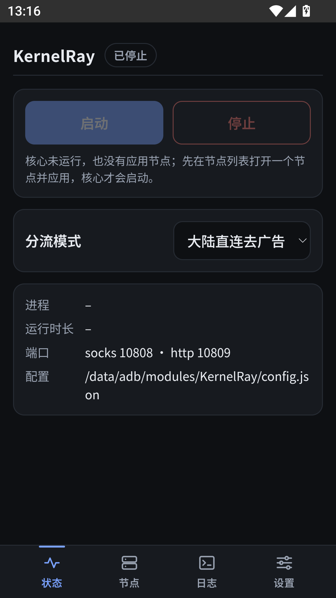

# KernelRay

A [KernelSU](https://kernelsu.org) module that runs an [Xray-core](https://github.com/XTLS/Xray-core)
on an Android device.

**v0.7 — transparent proxy (TPROXY takeover).** The core exposes local
`socks` / `http` inbounds on `127.0.0.1`. The WebUI keeps a node list; tapping a node opens a
detail dialog and its **Apply** button switches the core to it. Takeover is not optional:
**every core start** installs iptables TPROXY rules and policy routing, so all device traffic
(TCP/UDP, IPv4/IPv6, every UID) enters the core, with DNS answered by the core's DNS module
through the node. A start whose takeover cannot be enforced — another VPN owns the traffic, a
rule install fails, the core rejects the config — is **refused**: no rules and no core, so the
device stays direct instead of offline. It is fail-closed the other way too: while the rules
are up, a core that dies means no traffic instead of leaked traffic
([ADR 0011](docs/adr/0011-tproxy-switch-defaults-on-and-follows-the-core-start.md)).

**v0.9 — 分流模式 (routing modes).** Settings gains a routing mode: **全局** (the applied node
carries every destination — the default, and what every earlier version did) or **大陆直连**
(mainland domains and addresses leave by `direct`, everything else still goes through the
node, with DNS split to match so mainland domains are resolved by domestic resolvers). The geo
data those rules name (`geosite.dat`, `geoip.dat`) ships inside the module ZIP. Switching the
mode re-renders the config and restarts a running core; a missing geo file degrades to 全局
instead of a dead core ([ADR 0014](docs/adr/0014-geodata-ships-in-the-module-and-routing-is-a-preset-mode.md)).

## What it does

| | |
| --- | --- |
| starts | only when the user asks: the WebUI's 启动 button (or `kernelray.sh start`). Nothing starts at boot, and a start without an applied node stays refused |
| keeps state in | `/data/adb/modules/KernelRay/` — the module dir, and the *only* place we write |
| listens on | `127.0.0.1:10808` (socks5+socks5h), `127.0.0.1:10809` (http) — ports configurable on the WebUI settings page (state.json `settings`); wildcard `:10810` (tproxy, whenever the core runs) |
| outbound | the applied node, or `direct` for a destination the 分流规则 match; nothing starts until a node is applied |
| switches to a node | pressing **Apply** in a row's detail dialog writes `state.json` + the rendered outbound; the shell renders/tests/swaps `config.json` and restarts a running core — one render and one test, and no restart at all when the bytes do not change ([ADR 0017](docs/adr/0017-one-render-one-test-per-switch.md)) |
| takes over device traffic | every core start installs the module's own mangle/filter chains, capture fwmark 19283, bypass fwmark 19282, tables 19283/19282, rule pref 9500/9400; never touches another module's rules, and a start that cannot install them is refused |
| answers DNS | port 53 is captured into the core's DNS module; in 全局 its upstream is the DoH `https://1.1.1.1/dns-query` through the node, in 大陆直连 mainland domains ask `223.5.5.5` / `119.29.29.29` direct and everything else keeps the DoH; the applied node's own hostname resolves direct |
| routes | the 分流模式 in Settings: 全局 (default) or 大陆直连 (`geosite:cn` / `geoip:cn` → `direct`, with `geosite:private` / `geoip:private` kept local); the geo data ships in `bin/`, beside the core |
| WebUI | the only manual surface: start / stop, conflict / failure hints + retry, log, import nodes, switch the applied node from the node list; the 分流模式 and the 日志等级 live in Settings. The module ships no `action.sh`, so the manager's module card has no ▶ button ([ADR 0018](docs/adr/0018-no-action-button-and-no-boot-start.md)) |
| config | `config.json`, generated from `config.example.json`; never hand-edited |
| log | `logs/xray.log` (core, verbosity from the 日志等级 in Settings; rotated to `xray.log.1` at 1MB on a start) and `logs/kernelray.log` (module: rules, conflicts, starts) |

> **Everything lives in the module dir.** Nothing is written outside it, so uninstalling leaves no
> residue. The flip side: a module update replaces that directory wholesale, so `config.json`,
> `state.json`, `outbound.json`, `outbound.meta`, `runtime/` and the logs are reset when you upgrade (see
> [`docs/adr/0002`](docs/adr/0002-everything-lives-in-the-module-dir.md)).

Point any app, Termux command or adb-forwarded client at the socks port to check that the
core really is forwarding traffic — a live pid alone proves nothing. Without an applied node
the core does not start, so a working socks request always exits through the applied node.

## Transparent proxy (takeover)

There is no switch: takeover is what a core start *is*
([ADR 0011](docs/adr/0011-tproxy-switch-defaults-on-and-follows-the-core-start.md)).

- **Every start takes over.** A start without an applied node is refused by the gate (nothing
  to proxy), and every other start installs the rules and runs the one takeover config. There
  is no local-only mode: this module is a transparent proxy.
- **No core without takeover.** The start is ordered: conflict check and node pin first (while
  the network is still direct), then the config and its `xray -test`, then the rules, then the
  core. If any step fails the core is not started, the device goes direct, and the status
  reports `failed/conflict`, `failed/rules`, `failed/config-invalid` or `failed/no-config`; the
  WebUI offers a Retry that runs the same start. A config the core rejects therefore never
  leaves a live capture behind.
- **Fail-closed.** Once the rules are up they exist independently of the core's health: a core
  that crashes later leaves them in place, so traffic is dropped instead of going out direct.
- **What is captured.** Device-local TCP and UDP, IPv4 and IPv6, all UIDs — including DNS,
  even queries aimed at a LAN resolver. Bypassed: loopback, private/link-local/multicast
  ranges, DHCP, and the core's own connections (via the bypass mark). ICMP stays direct:
  `ping` is not proxied, that is documented behaviour, not a bug.
- **Conflicts refuse to fight.** A UP `tun*`/`wg*` interface, an always-on VPN setting or a
  foreign `-j TPROXY` rule blocks the takeover at start with `failed/conflict`. Detection is
  heuristic; the rule of thumb stands: only one transparent proxy may be active. The core does
  not start in that state — the conflict is the honest report, and resolving it or uninstalling
  are the two ways out.
- **The listener is not an open proxy.** The tproxy inbound binds a wildcard address; a filter
  rule drops direct access to port 10810 from anything but loopback.

Recovery cheat sheet. A device with no network and a running-status core that is dead means the
rules outlived it (fail-closed). Four ways out, all of them work without network: press
**Start** again (the rules are already up, so the start reuses them and re-runs the core);
`kernelray.sh unapply` (forgets the node and takes the capture down); reboot (netfilter does
not survive one, see [ADR 0018](docs/adr/0018-no-action-button-and-no-boot-start.md)); or
uninstall. There is no "switch it off" any more.
A core that died on its own shows up as **failed · core exited** on the Status page — the
pidfile outlived the process — so a dead core is not mistaken for a stopped one.
`failed/rules` means an install failed and was rolled back (see `logs/kernelray.log`);
`failed/conflict` means another VPN owns the traffic. The bypass routing copies the current
default route at start time; if the network changes while takeover is on, restart the core
(stop, then start) to rebuild it.

The mechanism details — namespace values and the rule set — are pinned down in
[`docs/adr/0008`](docs/adr/0008-takeover-namespace-boot-and-toggle-semantics.md),
built on [`docs/adr/0004`](docs/adr/0004-tproxy-takeover-is-module-owned-and-fail-closed.md)
and [`docs/adr/0006`](docs/adr/0006-dns-goes-through-the-core.md).

## 分流模式 (routing mode)

Settings has a routing mode, and it decides *where* traffic goes, not whether it is captured
([ADR 0014](docs/adr/0014-geodata-ships-in-the-module-and-routing-is-a-preset-mode.md)).

- **全局 (the default).** The applied node carries everything; only the module's fixed policy
  (DNS, the node's own lookup, bypass) routes anything elsewhere. This is what every earlier
  version did, so an update changes nothing until the user picks otherwise.
- **大陆直连.** Mainland domains (`geosite:cn`) and addresses (`geoip:cn`) go out `direct`;
  private destinations (`geosite:private`, `geoip:private`) stay local too. Everything else
  still leaves through the node. `domainStrategy` becomes `IPIfNonMatch`, so a domain no
  geosite category knows can still match `geoip:cn` after resolution.
- **DNS splits with it.** The fixed DoH upstream would answer mainland domains with overseas
  CDN addresses, and `geoip:cn` would then never match. In 大陆直连 those domains ask
  `223.5.5.5` and `119.29.29.29` (filtered by `expectIPs: ["geoip:cn"]`, so an overseas CDN
  answer falls through), and only those queries go direct; everything else keeps the DoH
  through the node.
- **It applies at once.** Changing the mode re-renders the config, tests it and restarts a
  running core — and rolls the mode back if the new config does not start. Nothing about
  routing needs the start-time ordering takeover does.
- **It reaches the local inbounds too.** The geo rules are authored whether or not a client is
  a taken-over app or a local socks client, so an app pointed at `127.0.0.1:10808` gets the
  same 分流.
- **The geo data ships with the module.** `bin/geosite.dat` + `geoip.dat` sit beside the core
  in the ZIP, so nothing is fetched at install or at start, and the data's age is the release's
  age. Which set is pinned is a per-release call recorded in the release notes: the release
  pins Loyalsoldier's (~7.4MB compressed) for its extra categories, while test builds use the
  copy that comes inside the core's own ZIP (~3.3MB). Both carry `cn` and `private`, and the
  XTLS set's `geoip:cn` is the larger of the two, so the pin never changes whether 大陆直连
  works. The files carry no version stamp of their own — Settings shows presence, not a set
  name. A module update resets the data with the rest of the module dir.
- **Missing data never bricks the core.** `routing cn` refuses to switch while the files are
  absent, and a start that finds them gone renders 全局 and logs it: the safe direction is
  "everything through the node", never a config that cannot load.

## Layout

| Path | Purpose |
| --- | --- |
| `module/` | The module itself; its **contents** become the root of the release ZIP |
| `module/module.prop` | id, version and **versionCode** — the only source of version information |
| `module/scripts/kernelray.sh` | shared helpers: paths, core probing, start/stop, apply, status; also the CLI used by the WebUI |
| `module/scripts/tproxy.sh` | takeover: rule install/remove, conflict detection, the start-time prepare/engage pair; also the 分流 blocks (DNS and routing) and the `tproxy status` / `routing` CLIs; sourced by `kernelray.sh` |
| `module/webroot/index.html` | the WebUI markup: plain HTML, no build step, no dependencies |
| `module/webroot/app.css` | WebUI styles; both palettes live here, keyed on the `data-theme` attribute |
| `module/webroot/theme.js` | the theme preference: valid values, `auto` resolution, and the `data-theme` stamp `<head>` runs before the first paint |
| `module/webroot/app.js` | WebUI logic: reads `state.json`, imports nodes, renders the node list and detail dialog, renders the applied node as an Xray outbound, drives the CLI |
| `docs/state-schema.md` | what `state.json` contains — the authority the UI writes against |
| `docs/config-derivation.md` | how `config.json` is generated, applied and rolled back |
| `docs/dev-workflow.md` | the adb install / verify / drive-the-UI loop we actually use, plus its traps |
| `docs/xray-guide.md` | the Xray official documentation, mapped onto what this module actually renders — which config block comes from where, every protocol/link we use, and where the official tutorials don't apply to us |
| `tests/parse.test.js` | share-link parser tests, run against the parser block inside the shipped `app.js` |
| `tests/outbound.test.js` | node → Xray outbound renderer tests, run against the shipped block |
| `tests/nodelist.test.js` | node store → list rows (applied/selected/changed markers) and detail-dialog button-state tests, run against the shipped block |
| `tests/link.test.js` | node → share-link and subscription-Base64 tests, round-tripped through the shipped parser |
| `tests/prefs.test.js` | Settings-page preference (theme, language, log buffer) normalise/load/save tests, run against the shipped block |
| `tests/theme.test.js` | theme pref → `data-theme` resolution, the system-following subscription and the head-time stamp, run against the shipped `theme.js` |
| `tests/config.test.js` | template assembly, the one render form, apply failure paths, start rollback and the 日志等级's start-time repair, run against the shipped shell + a fake core |
| `tests/tproxy.test.js` | rule install/remove, conflict detection, the start order (test before rules, no core without takeover) and the absence of any switch, run against fake iptables/ip binaries |
| `tests/routing.test.js` | 分流模式 render matrix (全局/大陆直连), the geo-data degradation and the `routing` CLI's failure paths, run against the shipped shell |
| `docs/webui.png` | screenshot of the WebUI |
| `module/config.example.json` | config template (placeholder, not runnable) used to generate `config.json` |
| `module/bin/` | the arm64 core and the geo data it loads (`geosite.dat`, `geoip.dat`), **not committed** — see `module/bin/README.md` |
| `module.yaml` | KernelSU Modules display metadata (name, summary, icon, tags, …) |
| `scripts/pack.sh` | builds `build/KernelRay-<versionCode>-<version>.zip` from `module/` |
| `GLOSSARY.md` | what we mean by node / subscription / selected node / module dir / takeover |
| `docs/adr/` | decisions worth remembering |

## Install

```sh
# 1. put the core and the geo data in place (see module/bin/README.md)
#     module/bin/xray                    <- Xray-android-arm64-v8a.zip
#     module/bin/{geosite,geoip}.dat     <- testing: the same ZIP; release: Loyalsoldier's
#     one command for all three, naming the files so the ZIP's own README.md is not extracted
#     over module/bin/README.md:
#       unzip -j Xray-android-arm64-v8a.zip xray geosite.dat geoip.dat -d module/bin/

# 2. build and flash
scripts/pack.sh
adb push build/KernelRay-*.zip //data/local/tmp/ && adb shell su -c 'ksud module install /data/local/tmp/KernelRay-*.zip'
```

`scripts/pack.sh` refuses to build without both, because `xray -test` loads the geo data: a ZIP
without it could not run 大陆直连 at all.

The install is only staged until the next reboot — KernelSU unpacks into
`/data/adb/modules_update/` and swaps it in at boot. See
[`docs/dev-workflow.md`](docs/dev-workflow.md) for the full loop (waiting for boot, verifying,
opening the WebUI, simulating an update or an uninstall) and the traps that come with it.

The module is arm64-only and ships one core at `bin/xray`. Install fails loudly if that
binary is missing or cannot execute on the device; x86_64 emulators run it via ARM
translation.

## Verify

```sh
# core alive, one instance only
ps -A -o PID,ARGS | grep 'xray run'
cat /data/adb/modules/KernelRay/runtime/status.json     # {"state":"running","node":"…"}
cat /data/adb/modules/KernelRay/runtime/applied         # empty until a node is applied, then the node id

# the core really forwards traffic
adb forward tcp:11080 tcp:10808
curl -sS -o /dev/null -w '%{http_code}\n' --socks5-hostname 127.0.0.1:11080 https://www.gstatic.com/generate_204
```

After applying a node in the WebUI, the same `curl` exits through that node. Without an applied
node the core does not start at all, so a successful socks request always means the applied
node carried it; check `runtime/applied` when the question is which node that was.

To verify that device traffic — not just the socks client — goes through:

```sh
adb shell su -c 'iptables -t mangle -S KR_TP_OUTPUT | head'   # the module's own rules
adb shell su -c '/data/adb/modules/KernelRay/scripts/kernelray.sh tproxy status'   # rules=present
adb shell su -c 'cat /data/adb/modules/KernelRay/logs/kernelray.log'
# a plain (non-socks) request from the device must exit through the node:
adb shell su -c 'curl -sS -o /dev/null -w "%{http_code} %{remote_ip}\n" https://www.gstatic.com/generate_204'
```

The `%{remote_ip}` is the node's exit, not the device's WAN IP. DNS is checked the same way:
`adb shell su -c 'ping -c1 -W2 host.example'` does not prove DNS (ICMP is direct), so use
`adb shell su -c 'nslookup www.google.com'` and compare the answer against what the node's
region would return.

With 大陆直连 selected, the same request to a mainland site must *not* exit through the node:

```sh
adb shell su -c 'cat /data/adb/modules/KernelRay/runtime/route'        # "cn" when selected
adb shell su -c 'grep -o "geosite:cn" /data/adb/modules/KernelRay/config.json'
adb shell su -c 'curl -sS -o /dev/null -w "%{remote_ip}\n" https://www.baidu.com'
# compare with a non-mainland site: that one still shows the node's exit
grep -i "geo data missing" /data/adb/modules/KernelRay/logs/kernelray.log   # must be empty
```

## WebUI

<p align="center"></p>

*The screenshot predates the node list and the node detail dialog; the Nodes tab is now a list
whose rows open a detail dialog.*

Open the module card in the KernelSU manager and tap **WebUI**. The page has four tabs —
**Status**, **Nodes**, **Log** and **Settings** — with the title and runtime badge pinned above
them:

- **Status** — start / stop the core, conflict / failure hints with a retry, and pid, uptime,
  ports, core version and config path.
- **Nodes** — the node list (tap a row to open its detail dialog; **Apply** there switches), per-row applied/changed markers, inline delete, edit-mode check + select-all + batch delete, and the import card.
- **Log** — the last N lines (N is a Settings preference, 200 by default), with a follow toggle.
- **Settings** — a **General** card with the theme (auto / 日间 / 夜间), the UI language
  (auto / 中文 / English), the log buffer size and the 日志等级 (关闭 / 错误 / 警告 / 信息 /
  调试), the inbound ports, and the 分流模式 (全局 / 大陆直连) with the pinned geo-data
  version under it. Theme, language and log buffer are
  WebView preferences; the ports live in `state.json`,
  the routing mode in `runtime/route` and the log level in `runtime/loglevel`, so none of
  them survives an update or uninstall. The log level applies at the next core start, not
  immediately; 调试 writes a lot, so switch back to 警告 when the diagnosis is done.

Tabs are hash routes (`#/status`, `#/nodes`, `#/log`, `#/settings`): a reload or a deep link
lands on the same tab, and anything else falls back to `#/status`. Only the visible tab is
polled, plus the status badge; switching tabs keeps each tab's scroll position and any
half-typed import.

The node list renders `state.manual` against `runtime/applied` — the id the current
`config.json` was built from. The applied row says **Applied**; a node that changed after a
re-import (same id) says **Changed** and its dialog offers **Re-apply**; a failed switch leaves
the attempted row selected-but-not-applied while the old row stays applied. The list does not
render subscription nodes in this version.

**Node detail dialog.** Outside edit mode, tapping a row opens a read-only dialog: node fields
(including the credentials, by design), the applied/selected/changed badges, and a split
**Copy link** button whose caret menu also copies the whole link as **Base64** (the one-line
subscription form; for vmess the link is already Base64 JSON, so that form is double-encoded on
purpose). The link is derived from the node fields, not stored, so it describes what the module
would run. Opening the dialog writes nothing and never touches the core. A **Copy link** failure
falls back from the async Clipboard API to a textarea + `execCommand`
([ADR 0016](docs/adr/0016-a-node-row-opens-a-detail-dialog.md)).

**Switching a node.** Pressing **Apply** in the dialog writes `state.selected` first, renders
the node to `outbound.json` + `outbound.meta`, then runs `kernelray.sh apply <id>`. The shell
pins the node's address while the old node still works, checks that `outbound.meta` names that
id, renders a candidate from the template in the form the live rules demand, runs `xray -test`
and swaps it in atomically, restarting a running core. A failed test leaves the old config and
the running core untouched; a candidate that tests but does not start is rolled back to the
previous config. One render and one test per switch, and nothing at all when the bytes on disk
are already that node's
([ADR 0017](docs/adr/0017-one-render-one-test-per-switch.md)): re-applying the applied node, or
saving a port / 分流模式 the config already carries, does not restart the core. A failed switch
is retried from the attempted node's dialog. See
[`docs/config-derivation.md`](docs/config-derivation.md).

**Adding nodes.** Paste one link per line (or a whole base64 subscription blob) into the import
card and hit *Parse*: every line is reported back individually, with parsed nodes ready to
import and rejects showing why (`hysteria2` is not supported, an `ss://` link carrying a SIP003
plugin is not supported, and so on). Supported: `vless`, `vmess` (base64 JSON), `trojan`, `ss`
(SIP002 and the legacy form). *Import* merges into `state.json` — re-importing the same node
updates it in place and keeps its id, so a rename does not create a duplicate.

Import normally only fills the node list and leaves the selection alone; open a row's dialog
and press **Apply** afterwards. The exception is an import into a store with no applied node: it
applies `selected` when that still resolves, else the first node the list shows, so the module is
usable without an extra tap — it never starts a stopped core, and it is the one apply path that
does not go through the detail dialog ([ADR 0012](docs/adr/0012-import-applies-the-first-node-when-nothing-is-applied.md)).
Deleting a node needs a second tap; deleting the selected node clears the selection. The applied
node is refused while the core is running or while another node is still in the list. It can be
deleted only when it is the last node and the core is stopped, and that delete is an unapply: the
core config, `runtime/applied`, the rendered outbound and the tproxy rules all go, so the core can
no longer start until a node is applied again
([ADR 0013](docs/adr/0013-deleting-the-last-node-while-stopped-unapplies-it.md)).

**Batch delete.** *Edit* turns the list into a check UI: each row gets a checkbox, tapping a
row toggles its check, and a toolbar offers select-all and a delete with the checked count.
The check set lives in memory only — leaving edit mode or the page discards it, and it never
touches `state.json`. The applied row's checkbox follows the same gate as its ✕ (it joins only
when it is the last node and the core is stopped), and the deletion goes through the same path as
a single delete, so the selected pointer and the rendered outbound are cleaned up the same way.

The parser, the node list model, the node-link generator, the outbound renderer and the UI
preferences are tested without a browser: `node tests/parse.test.js`, `node tests/nodelist.test.js`,
`node tests/link.test.js`, `node tests/outbound.test.js` and `node tests/prefs.test.js` extract
the marked blocks from the shipped `app.js`; `node tests/theme.test.js` evaluates the shipped
`theme.js` with `window`/`document` stubbed, the way `<head>` runs it.
`node tests/config.test.js` sources the shipped shell against a fake core and checks template
assembly, escaping, the one render form, apply's failure paths and the
start-rollback path. `node tests/tproxy.test.js` runs the rule installer, conflict detection,
the start order (the config is tested before the rules go in, and a start that cannot take
over is refused) against fake `iptables`/`ip` binaries that log their arguments.

The page is a dumb client: every core action runs the same CLI the shell uses, so behaviour
cannot diverge between the two entry points.

```sh
/data/adb/modules/KernelRay/scripts/kernelray.sh status   # key=value, consumed by the WebUI
/data/adb/modules/KernelRay/scripts/kernelray.sh log 50
/data/adb/modules/KernelRay/scripts/kernelray.sh start
/data/adb/modules/KernelRay/scripts/kernelray.sh stop
/data/adb/modules/KernelRay/scripts/kernelray.sh apply <node-id>
/data/adb/modules/KernelRay/scripts/kernelray.sh unapply    # forget the applied node: rules, config, applied id, outbound
/data/adb/modules/KernelRay/scripts/kernelray.sh tproxy status   # read-only: rules=present|absent
```

`apply` is the last step of the WebUI flow: it expects `outbound.json` and `outbound.meta` to
have been written by the UI for that id. The WebUI's node list is the selector; `apply` only
performs the switch it asked for.

No build step and no `npm install`: `webroot/index.html`, `app.css` and `app.js` are committed
as-is, and the page talks to the manager through the injected `ksu.exec` bridge. Opened outside
the manager it says so instead of pretending to work.

## Deliberately out of scope

A user-editable rule list (a rule model, ordering semantics, a validation UI), `geosite:`-based
ad blocking (the `block` outbound is in the template, unused), per-app proxying/bypass, fetching
a subscription URL (the page has no TLS-validating fetcher, and a subscription URL *is* a
credential), hand-editing `config.json`, tethering/forwarded traffic, TUN, watchdog/auto-restart,
multi-core support (sing-box/mihomo/…) — parked, not rejected; see `docs/adr/`.

## Releasing a new version

1. Enable **Settings → General → Releases → Enable release immutability** (once).
2. Bump `version` and `versionCode` in `module/module.prop` (versionCode must increase).
3. Commit, then tag and push:

   ```sh
   git tag v0.6.0 && git push origin v0.6.0
   ```

4. The workflow zips `module/`, prechecks it with the KernelSU Modules validator and publishes
   `KernelRay-<versionCode>-<version>.zip`.

> Note: cores are gitignored, so CI currently publishes a ZIP **without** cores. Until the
> workflow is extended to fetch pinned cores, release builds have to be produced locally.

## License

[MIT](LICENSE)
