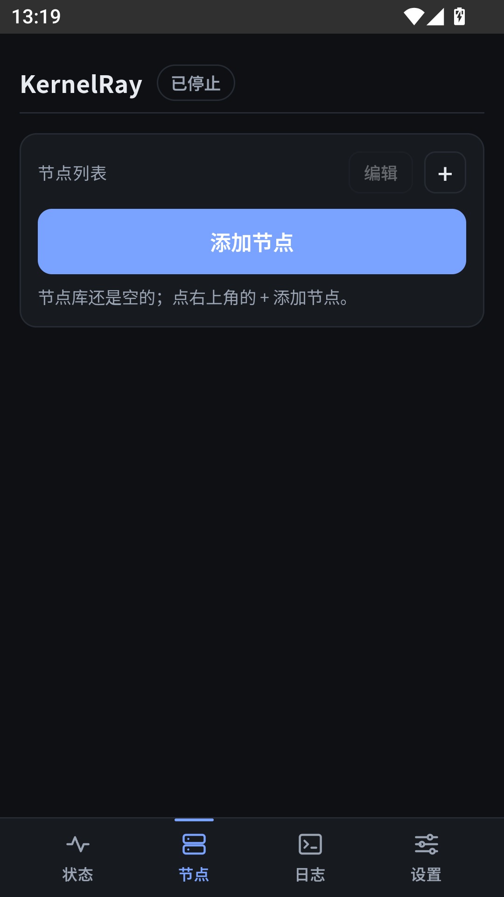
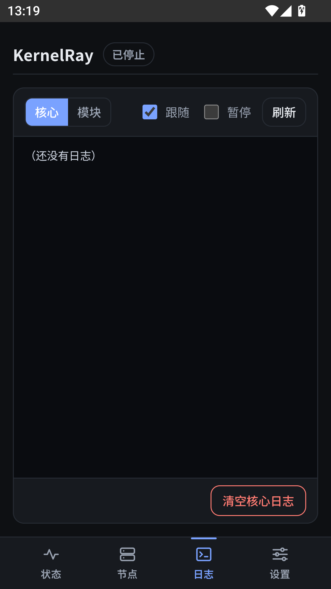
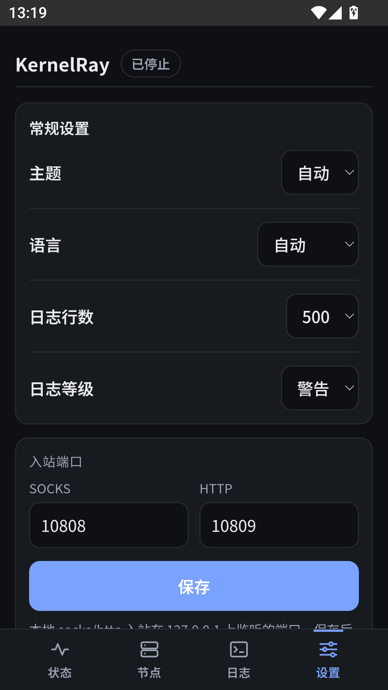

# KernelRay

**在 Android 上以 KernelSU 模块运行 Xray-core 的透明代理**

**[下载安装](#安装)**

## 特性

- **全设备接管** — TCP / UDP、IPv4 / IPv6、所有应用，无需逐应用配置
- **三种分流模式** — 全局 / 大陆直连 / 大陆直连去广告 一键切换；geo 数据随模块内置，安装后不联网拉取
- **多协议节点导入** — `vless` / `vmess` / `trojan` / `ss` 分享链接或整段 Base64 订阅粘贴即导入
- **WebUI 全程管理** — 启动/停止、节点导入与切换、日志、设置，全在一个页面
- **中文 / English 界面** — 日间 / 夜间 / 自动主题，UI 语言跟随或手动

## 系统要求

- 已 root 并安装 [KernelSU](https://github.com/tiann/KernelSU) 的 Android 设备（arm64）
- 没有其他 VPN / 透明代理在占用流量（同一时刻只能有一个）

## 安装

1. 从 [Releases](https://github.com/NueXini/KernelRay/releases) 下载 `KernelRay-<version>.zip`
2. 在 KernelSU 管理器中刷入，重启
3. 打开管理器的模块卡片，点 **WebUI**

## 截图

## License

[MIT](LICENSE)
