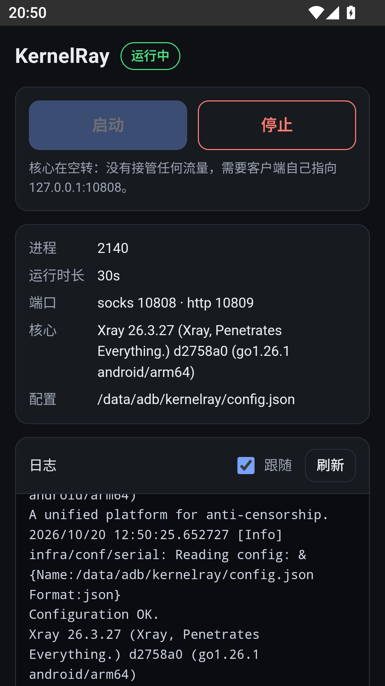

# KernelRay

A [KernelSU](https://kernelsu.org) module that runs an [Xray-core](https://github.com/XTLS/Xray-core)
on an Android device.

**v0.6 — switch between nodes, still no transparent proxy.** The core starts on boot and exposes
local `socks` / `http` inbounds on `127.0.0.1`. The WebUI keeps a node list; tapping a node
switches the core to it, so clients pointed at the socks port go through that node. System
traffic is not intercepted yet — no TPROXY, DNS hijacking, TUN or routing rules. That is v0.7.

## What it does

| | |
| --- | --- |
| starts on boot | `service.sh` (late_start service) launches the core with the applied config, or direct when none is applied |
| keeps state in | `/data/adb/modules/kernelray/` — the module dir, and the *only* place we write |
| listens on | `127.0.0.1:10808` (socks5+socks5h), `127.0.0.1:10809` (http) |
| outbound | the applied node; `freedom` (direct) until a node is applied |
| switches to a node | tapping a row in the WebUI writes `state.json` + the rendered outbound; the shell renders/tests/swaps `config.json` and restarts a running core |
| action button | toggles start/stop and prints status (`action.sh`) |
| WebUI | start / stop, log, import nodes, switch the applied node from the node list |
| config | `config.json`, generated from `config.example.json`; never hand-edited |
| log | `logs/xray.log` in the module dir |

> **Everything lives in the module dir.** Nothing is written outside it, so uninstalling leaves no
> residue. The flip side: a module update replaces that directory wholesale, so `config.json`,
> `state.json`, `outbound.json`, `outbound.meta` and the logs are reset when you upgrade (see
> [`docs/adr/0002`](docs/adr/0002-everything-lives-in-the-module-dir.md)).

Point any app, Termux command or adb-forwarded client at the socks port to check that the
core really is forwarding traffic — a live pid alone proves nothing. Without an applied node
the core forwards direct; after tapping a node in the WebUI the same request exits through it.

## Layout

| Path | Purpose |
| --- | --- |
| `module/` | The module itself; its **contents** become the root of the release ZIP |
| `module/module.prop` | id, version and **versionCode** — the only source of version information |
| `module/scripts/kernelray.sh` | shared helpers: paths, core probing, start/stop, apply, status; also the CLI used by the WebUI |
| `module/webroot/index.html` | the WebUI markup: plain HTML, no build step, no dependencies |
| `module/webroot/app.css` | WebUI styles, including the light/dark palettes |
| `module/webroot/app.js` | WebUI logic: reads `state.json`, imports nodes, renders the node list, renders the tapped node as an Xray outbound, drives the CLI |
| `docs/state-schema.md` | what `state.json` contains — the authority the UI writes against |
| `docs/config-derivation.md` | how `config.json` is generated, applied and rolled back |
| `docs/dev-workflow.md` | the adb install / verify / drive-the-UI loop we actually use, plus its traps |
| `tests/parse.test.js` | share-link parser tests, run against the parser block inside the shipped `app.js` |
| `tests/outbound.test.js` | node → Xray outbound renderer tests, run against the shipped block |
| `tests/nodelist.test.js` | node store → list rows (applied/selected/changed markers) tests, run against the shipped block |
| `tests/prefs.test.js` | Settings-page preference (language, log buffer) normalise/load/save tests, run against the shipped block |
| `tests/config.test.js` | template assembly, apply failure paths and start rollback, run against the shipped shell + a fake core |
| `docs/webui.png` | screenshot of the WebUI |
| `module/config.example.json` | config template (placeholder, not runnable) used to generate `config.json` |
| `module/bin/xray` | the arm64 core, **not committed** — see `module/bin/README.md` |
| `module.yaml` | KernelSU Modules display metadata (name, summary, icon, tags, …) |
| `scripts/pack.sh` | builds `build/kernelray-<versionCode>-<version>.zip` from `module/` |
| `GLOSSARY.md` | what we mean by node / subscription / selected node / module dir / idle run |
| `docs/adr/` | decisions worth remembering |

## Install

```sh
# 1. put the core in place (see module/bin/README.md)
#     module/bin/xray   <- Xray-android-arm64-v8a.zip

# 2. build and flash
scripts/pack.sh
adb push build/kernelray-*.zip //data/local/tmp/ && adb shell su -c 'ksud module install /data/local/tmp/kernelray-*.zip'
```

The install is only staged until the next reboot — KernelSU unpacks into
`/data/adb/modules_update/` and swaps it in at boot. See
[`docs/dev-workflow.md`](docs/dev-workflow.md) for the full loop (waiting for boot, verifying,
opening the WebUI, simulating an update or an uninstall) and the traps that come with it.

The module is arm64-only and ships one core at `bin/xray`. Install fails loudly if that
binary is missing or cannot execute on the device; x86_64 emulators run it via ARM
translation.

## Verify

```sh
# core alive, one instance only
ps -A -o PID,ARGS | grep 'xray run'
cat /data/adb/modules/kernelray/runtime/status.json     # {"state":"running","node":"…"}
cat /data/adb/modules/kernelray/runtime/applied         # empty until a node is applied, then the node id

# the core really forwards traffic
adb forward tcp:11080 tcp:10808
curl -sS -o /dev/null -w '%{http_code}\n' --socks5-hostname 127.0.0.1:11080 https://www.gstatic.com/generate_204
```

After switching to a node in the WebUI, the same `curl` exits through that node; before that it
is a direct freedom connection. The socks request proves the core works either way, so check
`runtime/applied` when the question is which path it took.

## WebUI

<p align="center"></p>

*The screenshot predates the node list; the Nodes tab is now a list of tappable rows.*

Open the module card in the KernelSU manager and tap **WebUI**. The page has four tabs —
**Status**, **Nodes**, **Log** and **Settings** — with the title and runtime badge pinned above
them:

- **Status** — start / stop the core and read pid, uptime, ports, core version and config path.
- **Nodes** — the node list (tap a row to switch and apply), per-row applied/changed markers, inline delete, and the import card.
- **Log** — the last N lines (N is a Settings preference, 200 by default), with a follow toggle.
- **Settings** — UI language (auto / 中文 / English) and the log buffer size. These are UI
  preferences: they live in the WebView's own storage, not in `state.json`.

Tabs are hash routes (`#/status`, `#/nodes`, `#/log`, `#/settings`): a reload or a deep link
lands on the same tab, and anything else falls back to `#/status`. Only the visible tab is
polled, plus the status badge; switching tabs keeps each tab's scroll position and any
half-typed import.

The node list renders `state.manual` against `runtime/applied` — the id the current
`config.json` was built from. The applied row says **Applied**; a node that changed after a
re-import (same id) says **Changed** and tapping it re-applies; a failed switch leaves the
attempted row selected-but-not-applied while the old row stays applied. Tapping the applied
node with no changes does nothing to the core. The list does not render subscription nodes in
this version.

**Switching a node.** A tap writes `state.selected` first, renders the node to `outbound.json`
+ `outbound.meta`, then runs `kernelray.sh apply <id>`. The shell checks that `outbound.meta`
names that id, renders a candidate from the template, runs `xray -test`, swaps it in atomically
and restarts a running core. A failed test leaves the old config and the running core
untouched; a candidate that tests but does not start is rolled back to the previous config. See
[`docs/config-derivation.md`](docs/config-derivation.md).

**Adding nodes.** Paste one link per line (or a whole base64 subscription blob) into the import
card and hit *Parse*: every line is reported back individually, with parsed nodes ready to
import and rejects showing why (`hysteria2` is not supported, an `ss://` link carrying a SIP003
plugin is not supported, and so on). Supported: `vless`, `vmess` (base64 JSON), `trojan`, `ss`
(SIP002 and the legacy form). *Import* merges into `state.json` — re-importing the same node
updates it in place and keeps its id, so a rename does not create a duplicate.

Import only fills the node list; it does not change the selection or how traffic flows. Tap a
node row afterwards to switch and apply it. Deleting a node needs a second tap; the applied
node cannot be deleted, and deleting the selected node clears the selection.

The parser, the node list model, the outbound renderer and the UI preferences are tested
without a browser: `node tests/parse.test.js`, `node tests/nodelist.test.js`,
`node tests/outbound.test.js` and `node tests/prefs.test.js` extract the marked blocks from
the shipped `app.js`.
`node tests/config.test.js` sources the shipped shell against a fake core and checks template
assembly, escaping, apply's failure paths and the start-rollback path.

The page is a dumb client: every core action runs the same CLI the shell uses, so behaviour
cannot diverge between the two entry points.

```sh
/data/adb/modules/kernelray/scripts/kernelray.sh status   # key=value, consumed by the WebUI
/data/adb/modules/kernelray/scripts/kernelray.sh log 50
/data/adb/modules/kernelray/scripts/kernelray.sh start
/data/adb/modules/kernelray/scripts/kernelray.sh stop
/data/adb/modules/kernelray/scripts/kernelray.sh apply <node-id>
```

`apply` is the last step of the WebUI flow: it expects `outbound.json` and `outbound.meta` to
have been written by the UI for that id. The WebUI's node list is the selector; `apply` only
performs the switch it asked for.

No build step and no `npm install`: `webroot/index.html`, `app.css` and `app.js` are committed
as-is, and the page talks to the manager through the injected `ksu.exec` bridge. Opened outside
the manager it says so instead of pretending to work.

## Deliberately out of scope (v0.6)

Transparent proxy (TPROXY/iptables), DNS hijacking, routing/geo rules, fetching a subscription
URL (the page has no TLS-validating fetcher, and a subscription URL *is* a credential),
hand-editing `config.json`, per-app proxying, TUN, watchdog/auto-restart, multi-core support
(sing-box/mihomo/…). The transparent proxy is the next slice (v0.7); the rest are parked, not
rejected — see `docs/adr/`.

## Releasing a new version

1. Enable **Settings → General → Releases → Enable release immutability** (once).
2. Bump `version` and `versionCode` in `module/module.prop` (versionCode must increase).
3. Commit, then tag and push:

   ```sh
   git tag v0.6.0 && git push origin v0.6.0
   ```

4. The workflow zips `module/`, prechecks it with the KernelSU Modules validator and publishes
   `kernelray-<versionCode>-<version>.zip`.

> Note: cores are gitignored, so CI currently publishes a ZIP **without** cores. Until the
> workflow is extended to fetch pinned cores, release builds have to be produced locally.

## License

[MIT](LICENSE)
